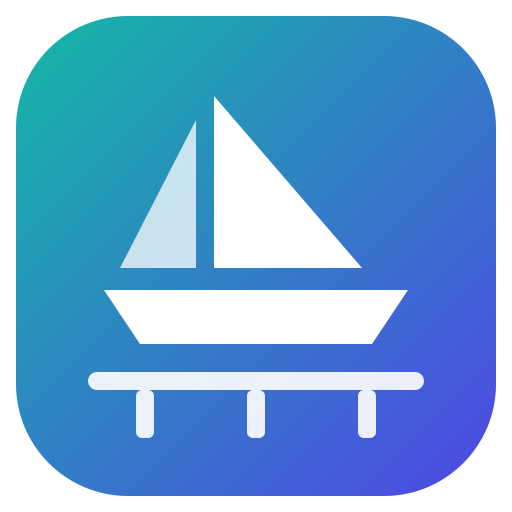
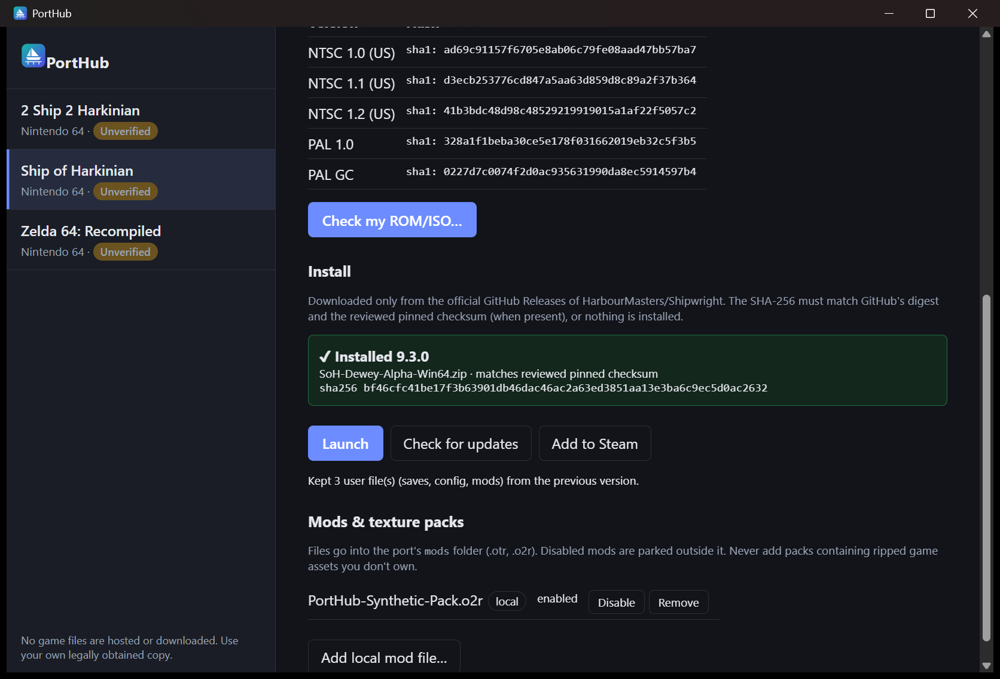
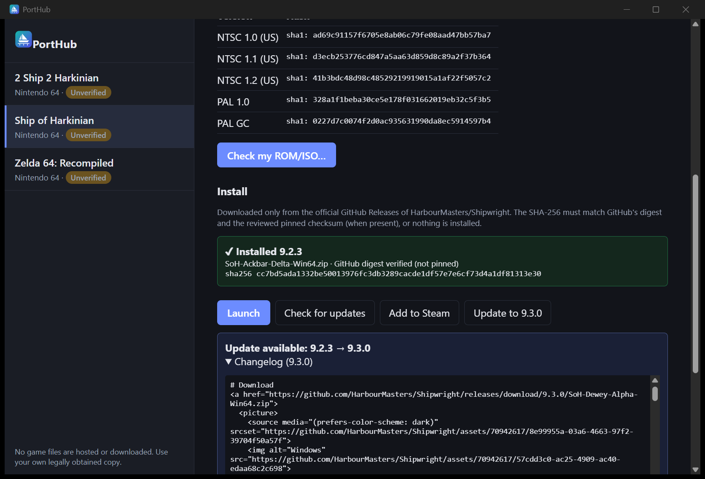
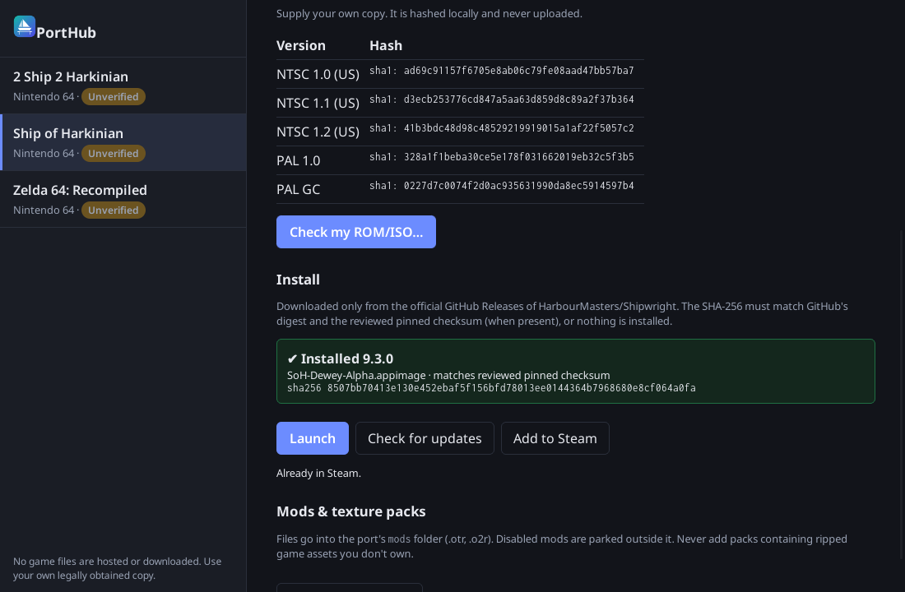

<p align="center">
  
</p>

<h1 align="center">PortHub</h1>

<p align="center"><b>One safe place to install, update and launch native PC ports of classic console games.</b></p>

<p align="center">
  <a href="https://github.com/DrummingBird1/PortHub/actions/workflows/ci.yml"></a>
  <a href="https://github.com/DrummingBird1/PortHub/releases"></a>
  <a href="LICENSE"></a>
  
</p>

> **Early preview (0.0.1).** It works end to end, but expect rough edges. All catalog entries are marked _Unverified_ until maintainers have tested them.

<p align="center">
  
</p>

## Bring your own ROM: we never host game files

PortHub **does not include, download or link to** ROMs, ISOs, BIOS files or game assets. It downloads only the port programs themselves, and only from each project's **official GitHub Releases**. You provide your own legally obtained game dump. PortHub hashes it locally to tell you whether it is a supported version, and the file never leaves your computer.

## Features

- **Catalog of ports.** Each port has a page with its description, upstream links, license, compatibility, and the game dumps it supports.
- **ROM check.** Hashes your dump locally (SHA-1/MD5/SHA-256) and tells you which supported version it matches.
- **Verified install.** Picks the right release asset for your OS. The SHA-256 must match GitHub's published digest, and the reviewed pinned checksum when there is one, or nothing is installed. Archives are extracted safely, with no path traversal and no symlinks.
- **Updates.** Compares your installed version with the latest release, shows the changelog, and upgrades in one click. Saves, configs and mods are kept.
- **Mods and texture packs.** Add local files, then enable, disable or remove them per port.
- **Add to Steam.** Creates a non-Steam shortcut, with a backup of `shortcuts.vdf`. It only does this while Steam is closed.
- **Small and locked down.** Tauri 2 with a Rust core. The UI can only call PortHub's own commands, and the CSP is strict. No telemetry.

| Update available                                           | Linux                                           |
| ---------------------------------------------------------- | ----------------------------------------------- |
|  |  |

## Supported ports

| Port                                                                     | Game                                 | Windows | Linux | Mods            |
| ------------------------------------------------------------------------ | ------------------------------------ | ------- | ----- | --------------- |
| [Ship of Harkinian](https://github.com/HarbourMasters/Shipwright)        | The Legend of Zelda: Ocarina of Time | ✅      | ✅    | `.otr` / `.o2r` |
| [2 Ship 2 Harkinian](https://github.com/2ship2harkinian/2ship2harkinian) | The Legend of Zelda: Majora's Mask   | ✅      | ✅    | `.otr` / `.o2r` |
| [Zelda64Recomp](https://github.com/Zelda64Recomp/Zelda64Recomp)          | The Legend of Zelda: Majora's Mask   | ✅      | ✅    | not yet         |

All credit for these ports goes to their upstream teams. PortHub is an unofficial launcher and is not affiliated with them or with Nintendo.

## Install

Download from [Releases](https://github.com/DrummingBird1/PortHub/releases):

- **Windows:** `PortHub_0.0.1_x64-setup.exe`. The installer is **not code-signed yet**, so SmartScreen may warn you. Click _More info_ → _Run anyway_.
- **Linux / Steam Deck (desktop mode):** `PortHub_0.0.1_amd64.AppImage` (`chmod +x`, then run it) or `PortHub_0.0.1_amd64.deb`.

Check your download against `SHA256SUMS`:

```sh
sha256sum -c SHA256SUMS --ignore-missing          # Linux
Get-FileHash .\PortHub_0.0.1_x64-setup.exe        # Windows PowerShell
```

## Quick start

1. Open PortHub and choose a game in the sidebar.
2. **Check my ROM/ISO…** shows whether your dump is supported. This step is optional.
3. **Install** downloads and verifies the official build.
4. **Launch.** The port asks for your ROM on first run and builds its own asset archive.
5. Later, use **Check for updates**, add mods, or click **Add to Steam**.

Installed ports live in `%LOCALAPPDATA%\dev.porthub.desktop\ports\` on Windows and `~/.local/share/dev.porthub.desktop/ports/` on Linux.

## How it works

```
catalog/<id>.json ──► validated against docs/schema/manifest.schema.json (in Rust)
        │
        ▼
GitHub Releases API (official repo only) ──► pick asset by OS + regex
        │
        ▼
download over HTTPS (github.com hosts only) ──► SHA-256 == GitHub digest (+ pinned)
        │
        ▼
safe extract ──► ports/<id>/app  + install.json + files.txt ──► launch
```

When you upgrade, any file that is **not** in the previous release's `files.txt` (saves, configs, mods, generated archives) is copied into the new version. If the new release ships a file with the same name, your copy is kept as `<name>.porthub-old`.

## Adding a port

Ports are plain JSON manifests in [`catalog/`](catalog), with no scripts. Copy [`docs/examples/shipwright.json`](docs/examples/shipwright.json), fill it in following the [schema](docs/schema/manifest.schema.json), run `npm run validate:catalog`, and open a pull request. The PR template contains the review checklist. In short:

- the official upstream repo, with a license that allows distributing builds
- binaries from GitHub Releases only
- no ROMs or assets anywhere
- the pinned SHA-256 equals GitHub's digest

See [CONTRIBUTING.md](CONTRIBUTING.md).

## Build from source

Prerequisites: Node 22+, Rust (stable), and the [Tauri 2 prerequisites](https://v2.tauri.app/start/prerequisites/) for your OS. On Linux that includes WebKitGTK 4.1.

```sh
npm ci
npm run tauri dev        # run in development
npm run check            # prettier, eslint, tsc, vitest (incl. catalog validation)
cd src-tauri && cargo fmt --check && cargo clippy --all-targets -- -D warnings && cargo test
npm run tauri build      # NSIS installer (Windows) / AppImage + deb (Linux)
```

Project layout: `src/` is the React UI, `src-tauri/src/` is the Rust core, `catalog/` holds the manifests, and `docs/` holds the schema, plan and research. See [AGENTS.md](AGENTS.md) for a module map.

## FAQ

**Where do I get the game?** Dump it from a cartridge or disc you own. PortHub can't help with that, and won't.

**Why "Unverified"?** A port is marked _Verified_ only after a maintainer has installed and launched that exact pinned release on that OS.

**Does PortHub phone home?** No. It only contacts `api.github.com` and GitHub's download hosts, and only when you install or check for updates.

**The window is blank or black on Linux.** Some GPU/driver setups (and VMs) have WebKitGTK compositing issues. Start PortHub with `WEBKIT_DISABLE_COMPOSITING_MODE=1`.

**macOS?** Not yet.

**Is the Steam Deck supported?** The Linux build works. Game Mode and Deck hardware haven't been tested yet.

## License

The app is licensed under [GPL-3.0-or-later](LICENSE). The catalog manifests in [`catalog/`](catalog) are released under [CC0-1.0](catalog/LICENSE). Game names and trademarks belong to their owners.
